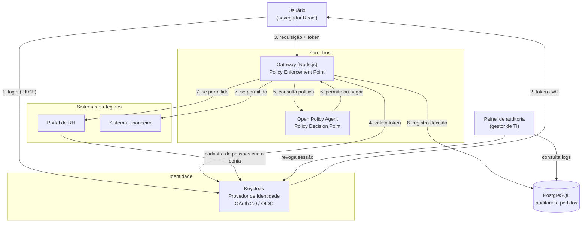

# Plataforma de autenticação federada com arquitetura Zero Trust

Projeto Integrador do módulo **Distributed and Secure Solutions** (ENIAC, Guarulhos).
Autor: Gabriel dos Santos Ribeiro.

> README provisório do repositório. **Protótipo acadêmico**: roda localmente, com dados fictícios, e o **MFA é simulado** (veja "Segurança").

---

## O problema

Empresas que crescem juntando sistemas (RH, financeiro, CRM) acabam com um login por sistema. Isso gera senhas repetidas, nenhuma visão central de quem acessa o quê e uma defesa baseada em "quem passou do login está confiável". Credenciais roubadas viram a porta de entrada mais comum para invasões.

## A solução

Uma plataforma em que:

1. **O login é federado:** uma identidade única (Keycloak, OAuth 2.0 + OpenID Connect) vale para todos os sistemas (login único, SSO).
2. **Nenhuma requisição é confiável por padrão (Zero Trust):** a cada acesso, um gateway valida o token e consulta uma política que decide permitir ou negar, considerando perfil, horário e postura do dispositivo.
3. **Tudo fica registrado:** cada decisão, permitida ou negada, entra na auditoria, e um gestor pode revogar sessões na hora.

Cenário fictício: a **Aurora Holdings**, com um **Portal de RH** e um **Sistema Financeiro**.

## Arquitetura



| Peça | Papel |
|---|---|
| **Keycloak** | Login, SSO, tokens JWT, perfis, revogação de sessão, guarda das senhas (hash com salt) |
| **Gateway** (`backend-zero-trust/gateway`) | PEP: única porta de entrada dos sistemas. Autentica, pergunta ao OPA, registra e aplica a decisão |
| **Open Policy Agent** | PDP: as regras de acesso, em Rego, separadas do código |
| **APIs de RH e Financeiro** | Sistemas de exemplo; só o gateway consegue alcançá-los (não expostas) |
| **PostgreSQL** | Auditoria das decisões e pedidos de acesso |
| **Front React** (`telas-zero-trust`) | Login pelo Keycloak e as telas dos sistemas, ligadas ao gateway |

## Regras de acesso (política)

Negar por padrão. O acesso só é liberado se **todas** estas condições valem:

- **Perfil:** `acesso_financeiro` para o Financeiro; `acesso_rh` ou `analista_rh` para o RH.
- **Horário:** das 7h às 20h (São Paulo).
- **Dispositivo:** postura "confiável" (simulada no protótipo).
- **Exceção temporária:** um gestor de área pode aprovar um pedido de acesso por 1h, 4h, 1 dia ou 3 dias. A exceção contorna perfil e horário, **nunca** dispositivo não confiável.

Perfis: `acesso_financeiro`, `acesso_rh`, `analista_rh` (cadastra pessoas), `gestor_area` (aprova pedidos), `gestor_ti` (auditoria e revogação).

## Telas

| # | Tela | Dados |
|---|---|---|
| 1 | Login | Página do Keycloak (OIDC + PKCE) |
| 2 | Portal de sistemas | `GET /me` |
| 3 | Sistema Financeiro | `GET /api/financeiro/lancamentos` |
| 4 | Acesso negado | Corpo do 403 do gateway |
| 5 | Painel de auditoria | `GET /admin/auditoria`, revogação de sessão |
| 6 | Portal de RH | `GET /api/rh/pessoas` |
| 7 | Cadastro de pessoas | `POST /admin/pessoas` |
| 8 | Solicitar acesso | `POST /solicitacoes` |
| 9 | Solicitações pendentes | `GET` e `PATCH /solicitacoes` |

## Tecnologias

| Camada | Tecnologias |
|---|---|
| Identidade | Keycloak 26.0.7 (OAuth 2.0, OpenID Connect, Authorization Code + PKCE, JWT) |
| Política | Open Policy Agent 1.0.0 (Rego) |
| Gateway e APIs | Node.js 20, Express 4, `jose`, `http-proxy-middleware`, `pg` |
| Banco | PostgreSQL 16 |
| Front-end | React 19, Vite 5, Tailwind CSS 3, `oidc-client-ts` |
| Infraestrutura | Docker e Docker Compose |
| Testes | `opa test`, Vitest, Testing Library |

## Estrutura do repositório

```
README.md                 este arquivo
backend-zero-trust/       Docker Compose, Keycloak, OPA, gateway, APIs, banco
  docker-compose.yml        sobe todo o ambiente
  keycloak/                 realm gerado por script, tema de login, notas
  opa/                      política (acesso.rego, data.json) e testes
  gateway/                  PEP em Node.js
  api-financeiro/ api-rh/   sistemas protegidos de exemplo
  db/init.sql               tabelas de auditoria e solicitações
  testes/demo.sh            roteiro de demonstração por terminal
telas-zero-trust/         front-end React integrado ao gateway
```

Cada pasta tem o seu próprio README, com mais detalhes.

## Como rodar

Precisa de Docker (com Compose) e Node.js 20 ou mais novo.

```bash
# 1. Backend (Keycloak em :8080, gateway em :4000)
cd backend-zero-trust
cp .env.example .env
docker compose up --build

# 2. Front-end, em outro terminal (http://localhost:5173)
cd telas-zero-trust
npm install
npm run dev
```

Abra **http://localhost:5173** (precisa ser `localhost`). Usuários de teste, todos com a senha `Senha@123` (só para desenvolvimento):

| Usuário | Perfil |
|---|---|
| `maria.silva` | Colaboradora do Financeiro |
| `joao.pereira` | Sem acesso ao Financeiro |
| `paulo.mendes` | Analista de RH |
| `fernanda.lima` | Gestora de área |
| `carlos.lima` | Gestor de TI |

Na barra azul da aplicação dá para simular **dispositivo não confiável** e **horário** (10h ou 22h). Fora das 7h–20h, use "Simular 10h". No login, o campo de código (MFA) aceita **6 dígitos quaisquer**.

## Testes

- `opa test opa/policies opa/testes` (em `backend-zero-trust`): 10 testes da política.
- `npm test` (em `telas-zero-trust`): testes unitários. `E2E=1 npm test` roda também 7 testes de integração do app contra o gateway real (precisa do backend no ar e zerado).
- `backend-zero-trust/testes/demo.sh`: roteiro por terminal com login, bloqueios, auditoria e revogação.

**Verificado com Keycloak 26.0.7, PostgreSQL 16 e OPA reais, fora do Docker:** política, gateway ponta a ponta (38 cenários), importação do realm com senhas em hash, fluxo de login do navegador (Authorization Code + PKCE, por script) e os testes de integração do front.
**Ainda não verificado:** o `docker-compose.yml` em si, o login em navegador real e o MFA (TOTP) real.

## Segurança

**O que o protótipo faz**
- Tokens de 5 minutos, renovados por refresh token; PKCE obrigatório no cliente do navegador.
- O gateway confere assinatura, emissor, validade e se o token **não foi revogado** (introspecção a cada requisição).
- Falha fechada: se o OPA ou o Keycloak estiverem fora do ar, o acesso é negado.
- Senhas guardadas pelo Keycloak com **hash PBKDF2-SHA512 e salt aleatório** (210.000 iterações). O arquivo do realm não tem senha em texto puro.
- Auditoria de toda decisão. Tentativas sem token não gravam no banco (evita encher a tabela).
- Pedidos de acesso validados contra a auditoria; ninguém decide o próprio pedido; o analista de RH não consegue criar um gestor de TI.

**Limitações conhecidas**
- **MFA simulado:** o campo de código no login é só visual (não é enviado nem validado). O login vale só com usuário e senha, e o gateway não confere se houve MFA.
- **Postura do dispositivo e hora simuladas** por cabeçalhos da barra de demonstração. Em produção, o dispositivo viria de um agente confiável e a hora do servidor (`PERMITIR_SIMULACAO=false`).
- Keycloak em modo de desenvolvimento, sem HTTPS; o cliente `demo-cli` (login por senha direta) existe só para testes.
- Exceções temporárias ficam na memória do OPA e somem se ele reiniciar.
- Qualquer gestor de área vê e decide pedidos de qualquer sistema.
- O gateway não valida o `audience` do token.

## Próximos passos

1. **MFA real (TOTP) para todas as contas:** desligar o campo simulado, tornar "Configure OTP" obrigatório no Keycloak e testar o primeiro login.
2. Exigir MFA no gateway (token vindo de login com MFA) e ao **aprovar pedidos**.
3. Limitar cada gestor de área ao seu sistema.
4. Persistir as exceções temporárias e validar o `audience`.
5. HTTPS, remover o `demo-cli` e um tema do Keycloak com o visual do projeto.
